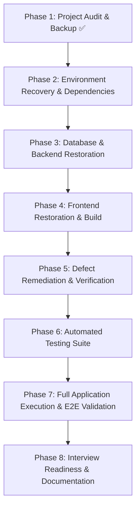

# AI Alumni Nexus — Comprehensive Project Audit & Diagnostics

**Audit Date:** October 14, 2026  
**Auditor:** Senior Full-Stack, DevOps & QA Reviewer  
**Repository Source of Truth:** [GitHub: theprince09/AI-Alumni-Nexus](https://github.com/theprince09/AI-Alumni-Nexus)  
**Local Workspace:** `c:\Users\gursi\OneDrive\Desktop\nexus-complete`

---

## 1. Executive Summary & Project Purpose

**AI Alumni Nexus** is a full-stack alumni networking and mentorship platform designed for universities, colleges, and educational communities. Its core purpose is to bridge the gap between students, alumni, and campus administration through:
- **Verified Alumni Engagement:** Multi-tier verification using academic domain emails (`.edu`, `ac.in`, etc.), registration numbers, passing year, and administrative vetting.
- **Structured Mentorship Lifecycle:** Booking, status management (requested, accepted, upcoming, completed, feedback/ratings), availability slots, and multi-channel communication (in-app, email, video link).
- **Opportunity & Referral Pipeline:** Verified alumni post job, internship, hackathon, and referral opportunities; students submit applications and track review statuses (`applied` → `reviewing` → `shortlisted` → `selected` / `rejected`).
- **AI-Powered Career Tools:** Skills gap analysis, mock interview simulator with real-time answer scoring, ATS resume reviewer, and personalized career roadmaps (with built-in offline fallbacks).
- **Real-Time Interactive Community:** Real-time WebSocket chat rooms with typing indicators and online presence tracking, activity feed with posts and comments, and campus events.
- **Role-Based Admin Oversight:** Platform metrics, alumni approval dashboard, role transitions, and system-wide announcements.

---

## 2. Architecture & Technology Stack

### Architecture Overview
The application follows a decoupled client-server architecture organized as a monorepo containing `client/` and `server/`:
- **Client Tier:** Single Page Application (SPA) built with React 18, Vite, React Router v6, Axios, Recharts, and Socket.io Client.
- **Server Tier:** REST API & WebSocket server built with Node.js, Express, Socket.io, and Mongoose ORM connecting to MongoDB.
- **Security & Reliability Layer:** Helmet HTTP headers, express-rate-limit throttlers, HTTP-only JWT cookies with SHA-256 hashed refresh token rotation, express-validator schema validation, and structured error file logging.

### Technology Stack & Detected Versions

| Component | Technology | Target / Configured Version | Detected on Current Host | Status |
|---|---|---|---|---|
| Runtime | Node.js | v20+ / v21+ | v21.6.1 | ✅ Compatible |
| Package Manager | npm | v10+ | 10.5.2 | ✅ Compatible |
| Database | MongoDB | v7.x | MongoDB v7.0.8 (Service Running on 27017) | ✅ Available |
| Backend Framework | Express | ^4.18.2 | Node module present (Mac symlinks broken) | ⚠️ Reinstall needed |
| Realtime WebSockets | Socket.io | ^4.7.5 | Node module present | ⚠️ Reinstall needed |
| Database ORM | Mongoose | ^8.3.4 | Node module present | ⚠️ Reinstall needed |
| Authentication | JWT + bcryptjs | jsonwebtoken ^9.0.2, bcryptjs ^2.4.3 | Pure JS implementation | ✅ Compatible |
| Frontend Framework | React | ^18.2.0 | Node module present | ⚠️ Reinstall needed |
| Frontend Bundler | Vite | ^8.0.11 / ^5.x | Symlink missing, binaries missing | ❌ Blocker |
| Version Control | Git | Git 2.38.1+ | git 2.38.1.windows.1 | ✅ Installed |

---

## 3. Discrepancy Analysis: Local ZIP vs. GitHub Remote Repository

A clean clone of `https://github.com/theprince09/AI-Alumni-Nexus` was fetched to a comparison directory and compared against the transferred local archive:

| Area | Remote GitHub (`main`) | Local Transferred ZIP | Diagnostic Finding |
|---|---|---|---|
| **Commit History** | 1 initial commit (`bf56b4e Initial commit for AI Alumni Nexus`) | No `.git` metadata in ZIP | ZIP excluded `.git` folder |
| **Directory Structure** | Flat frontend-only root (`src/`, `index.html`, `vite.config.js`) | Monorepo structure (`client/`, `server/`) | Local contains a massive evolution ("Phase 1 Production Core") |
| **Backend Implementation** | Completely absent from GitHub | Full Express/MongoDB backend with 9 models, 9 route modules, utilities, seeds | **Crucial:** GitHub contains only early prototype frontend; local copy holds the genuine full-stack application |
| **Frontend Implementation** | Early basic components | 18 full-featured pages, contexts (`AuthContext`, `LayoutContext`, `SocketContext`), unified `api.js` | Local contains modern full-featured client |
| **Configuration Files** | `.gitignore`, `eslint.config.js` | Missing `.gitignore`, added `.env` | Remote has `.gitignore`; local needs `.gitignore` restored |
| **Integrity Verdict** | Outdated initial prototype | **Authoritative modern source of truth** | **DO NOT OVERWRITE LOCAL CODE WITH GITHUB.** Local work represents the completed Phase 1 implementation. |

---

## 4. Existing Features & Implementation Status

| Feature / Module | Route / Endpoint | Backend Status | Frontend Status | Overall Status |
|---|---|---|---|---|
| **Authentication & Tokens** | `/api/auth/*` | ✅ Implemented (JWT, RefreshToken rotation, bcrypt) | ✅ Implemented (`Login.jsx`, `Signup.jsx`) | Ready for validation |
| **College Email Verification** | `/api/auth/verify-college-email` | ✅ Implemented (OTP code, 15m expiration) | ✅ Implemented (Signup banner, verification notices) | Ready for validation |
| **Admin Alumni Review** | `/api/users/alumni-verifications` | ✅ Implemented (review, approve, reject with reason) | ✅ Implemented (`AdminDashboard.jsx`) | Ready for validation |
| **Mentorship Lifecycle** | `/api/mentorship/*` | ✅ Implemented (availability, sessions, feedback) | ✅ Implemented (`Mentorship.jsx`) | Ready for validation |
| **Opportunities & Applications** | `/api/opportunities/*` | ✅ Implemented (post, apply, status workflow) | ✅ Implemented (`Opportunities.jsx`) | Ready for validation |
| **In-App Notifications** | `/api/notifications/*` | ✅ Implemented (polling model, mark read) | ✅ Implemented (`Notifications.jsx`, `Topbar.jsx`) | Ready for validation |
| **Community Feed & Posts** | `/api/posts/*` | ✅ Implemented (CRUD, like, comment, stats) | ✅ Implemented (`Feed.jsx`) | Ready for validation |
| **Direct Messaging & Chat** | `/api/messages/*` & Socket.io | ✅ Implemented (rooms, history, real-time sync) | ✅ Implemented (`ChatPage.jsx`, `SocketContext.jsx`) | Ready for validation |
| **Campus Events** | `/api/events/*` | ✅ Implemented (admin CRUD, user registration) | ✅ Implemented (`Events.jsx`) | Ready for validation |
| **AI Career Suite** | `/api/ai/*` | ✅ Implemented (OpenAI + built-in fallback stubs) | ✅ Implemented (`SkillAnalyzer`, `ResumeReview`, `MockInterview`) | Fully operational offline |
| **Alumni Directory** | `/api/users/alumni` | ✅ Implemented (search, skills, availability filter) | ✅ Implemented (`AlumniDirectory.jsx`) | Ready for validation |
| **User Profile Management** | `/api/users/me` | ✅ Implemented (completion %, skills, links) | ✅ Implemented (`Profile.jsx`) | Ready for validation |

---

## 5. Potential Security & Privacy Issues

1. **Exposed Atlas Credentials in `server/.env`:**
   - The archive includes `server/.env` with an active MongoDB Atlas connection string (`mongodb+srv://princeraj0905_db_user:...`) and an exposed `JWT_SECRET`.
   - *Remediation:* Create clean `.env.example` templates; configure local development to use the local MongoDB database instance (`mongodb://127.0.0.1:27017/alumni_nexus`) to ensure offline reliability and data privacy.
2. **Missing `.gitignore`:**
   - Neither the root nor subdirectories contain a `.gitignore`, exposing `.env`, `node_modules`, and error logs to accidental commit.
   - *Remediation:* Add a comprehensive root `.gitignore`.
3. **CORS & Cookie Configuration in Development:**
   - `server/server.js` sets `secure: process.env.NODE_ENV === "production"`, which correctly allows HTTP cookies over `localhost:5173`.
   - Rate limiting on `/api/auth` is set to 25 attempts per 15 minutes, which provides brute-force protection.
4. **Alumni Verification Authorization Guards:**
   - Routes creating opportunities and updating mentorship availability strictly enforce `requireVerifiedAlumni`, preventing unverified accounts from publishing unvetted content.

---

## 6. Startup & Execution Blockers

### Blocker B1: Nested Directory Misplacement from ZIP Extraction
- **Cause:** When extracted on Windows, the zip extracted into `c:\Users\gursi\OneDrive\Desktop\nexus-complete\nexus-complete\`.
- **Impact:** Any commands executed in the workspace root (`c:\Users\gursi\OneDrive\Desktop\nexus-complete`) fail because `client/` and `server/` are nested one level deeper.
- **Resolution:** Elevate/flatten project files directly to root or provide unified monorepo scripts that navigate cleanly.

### Blocker B2: Cross-Platform Node Modules Incompatibility (macOS → Windows)
- **Cause:** The project was packaged on macOS with Darwin `node_modules`. Windows ZIP extraction does not generate Windows executable batch files (`.cmd`, `.ps1`) in `node_modules/.bin/`.
- **Impact:** Running `npm run dev` or `npm run build` results in:
  - `'vite' is not recognized as an internal or external command`
  - `'nodemon' is not recognized as an internal or external command`
- **Resolution:** Run fresh `npm install` inside both `client/` and `server/` to construct native Windows binaries and shims.

### Blocker B3: Remote Database Dependency & Network Isolation
- **Cause:** `server/.env` specifies a remote cloud MongoDB Atlas connection that depends on active external internet, valid IP whitelisting, and valid credentials.
- **Impact:** Startup will crash or hang if internet is disconnected or if Atlas IP whitelist rejects the new laptop's IP address.
- **Resolution:** Local MongoDB (`v7.0.8`) is verified active and running on `localhost:27017`. Set `MONGODB_URI=mongodb://127.0.0.1:27017/alumni_nexus` in development.

### Blocker B4: Orphaned Duplicate Page Files in Client
- **Cause:** `client/src/pages/` contains both `Events.jsx` and `EventsPage.jsx`, as well as `Profile.jsx` and `ProfilePage.jsx`.
- **Analysis:** `App.jsx` imports `Events.jsx` and `Profile.jsx`. `EventsPage.jsx` and `ProfilePage.jsx` are obsolete legacy prototypes with mismatched API calls.
- **Resolution:** Document their presence and preserve or archive them cleanly without disrupting active imports.

---

## 7. Prioritized Recovery & Verification Plan

1. **P0 (Blockers):**
   - Clean and run `npm install` in `server/` to generate Windows shims.
   - Clean and run `npm install` in `client/` to generate Windows shims and verify Vite build.
   - Point `server/.env` to local MongoDB service (`mongodb://127.0.0.1:27017/alumni_nexus`).
   - Run `node seed.js` to populate initial demo accounts (Admin, Alumni, Student) and test data.
2. **P1 (Core Correctness):**
   - Verify backend server starts and `/` healthcheck responds with `{ status: "ok" }`.
   - Test login flow for all three roles (`admin@nexus.com`, `alumni@nexus.com`, `student@nexus.com`).
   - Verify all REST endpoints with curl or Node tests.
   - Build client production bundle (`npm run build`) to ensure zero JSX/TypeScript errors.
3. **P2 (Testing & Quality):**
   - Implement an automated test suite (`tests/api.test.js`) verifying auth, alumni verification, mentorship, and opportunities.
   - Add root `package.json` for unified monorepo management (`npm run dev:all`, `npm test`).
4. **P3 (Interview Readiness):**
   - Create comprehensive `README.md`, `PROJECT_WALKTHROUGH.md`, and `RECOVERY_REPORT.md`.
