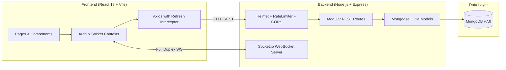

# AI Alumni Nexus — Technical Project Walkthrough & Interview Guide

This guide is designed for technical presentations, system architecture walkthroughs, and engineering interviews. It highlights real design decisions, implementation details, challenges encountered during the recovery from macOS to Windows, and accurate talking points grounded directly in the codebase.

---

## 1. The Problem the Project Solves

Traditional alumni networks and general platforms (e.g. LinkedIn) suffer from three critical problems in higher education environments:
1. **Unverified Claims:** Anyone can claim affiliation with an institution or company without verified academic records.
2. **Lack of Structured Mentorship Workflows:** Standard outreach via cold messaging has low conversion rates, no scheduling lifecycle, no availability state management, and zero feedback accountability.
3. **Fragmented Career Guidance:** Students juggle disconnected tools for resume reviews, interview preparation, job applications, and mentorship.

**AI Alumni Nexus** solves this by unifying verified alumni identity management, a structured request-to-feedback mentorship lifecycle, an opportunity referral board, and an AI-driven career suite into a cohesive institutional platform.

---

## 2. Who the Intended Users Are

The platform serves three distinct user personas, each with dedicated navigation, permissions, and dashboards:
- **Students:** Seek guidance, explore alumni career trajectories, schedule mentorship sessions, apply for exclusive internal opportunities, and practice technical interviews.
- **Alumni (Verified):** Control their availability (`available`, `busy`, `unavailable`), define weekly time slots, accept or reject student session bookings, post job/internship opportunities with internal referrals, and review candidate applications.
- **Administrators:** Review alumni credential proofs (college email domain, registration number, graduation year), approve or reject applications with audit notes, monitor college-wide engagement metrics, and announce workshops and hackathons.

---

## 3. Main Product Decisions & Rationale

1. **Two-Stage Alumni Verification:**
   - *Decision:* Require both automated college email OTP verification (`.edu`, `ac.in`) AND administrative review.
   - *Rationale:* Automated email domain matching prevents arbitrary public email registrations (e.g., `@gmail.com`), while admin vetting guarantees graduation status, preventing students from impersonating alumni.
2. **Explicit Mentorship Lifecycle States:**
   - *Decision:* State machine: `requested` → `upcoming` (or `rejected`) → `completed` → `feedback`.
   - *Rationale:* Cold messaging leaves students in limbo. A formal state machine forces a response, locks in meeting details (e.g., video link and time), and requires a post-session 5-star rating to maintain mentor accountability.
3. **Decoupled Fallback for AI Features:**
   - *Decision:* Provide offline, rule-based fallback counsel in `server/routes/ai.js` if `OPENAI_API_KEY` is not configured.
   - *Rationale:* Guarantees the application remains 100% functional, testable, and demonstrable in air-gapped, offline, or credential-free interview environments.

---

## 4. Architecture & Technology Choices

- **Frontend: React 18 SPA with Vite:**
  - Fast Hot Module Replacement (HMR), lightweight build footprint, and predictable client-side routing via React Router DOM v6.
- **Backend: Node.js with Express & ES Modules:**
  - Event-driven non-blocking I/O ideal for concurrent chat rooms, real-time presence tracking, and REST endpoints.
- **Database: MongoDB with Mongoose:**
  - Document-oriented schema flexibility accommodates varied user profiles (alumni with company/experience vs. students with branch/year), dynamic mentor time slots, and embedded notification preferences.
- **Authentication: Hybrid JWT with Refresh Token Rotation:**
  - Short-lived Access Tokens (15 min) in memory and secure HTTP cookies paired with long-lived (14 day) Refresh Tokens stored as SHA-256 hashes in MongoDB, featuring one-time rotation and instant revocation on logout.

---

## 5. Important Implementation Details

### 1. Token Refresh Interceptor with Request Replay (`client/src/api.js`)
Axios response interceptor catches `401 Unauthorized` responses on expired access tokens, pauses the failing request, requests a new access token from `/api/auth/refresh`, updates the local token store, and transparently replays the original failed request without logging out the user.

### 2. Dual Authorization Middleware (`server/middleware/auth.js`)
- `verifyToken`: Decodes JWT from `Authorization: Bearer <token>` or HTTP-only `accessToken` cookie.
- `requireRole`: Restricts administrative routes (`/api/users/stats`, `/api/users/alumni-verifications`).
- `requireVerifiedAlumni`: Strict guard ensuring only alumni whose email is verified AND administrative status is `verified` can post opportunities or alter mentorship availability.

### 3. Real-Time Chat & Online Presence (`server/server.js`)
Maintains an in-memory `Map` of online user socket IDs, broadcasting `users:online` updates upon connection and disconnection, while routing room messages via `io.to(room).emit("message:receive", message)`.

### 4. Robust Notification System with Aggregation (`server/routes/notifications.js`)
Unifies notifications under a dedicated schema with polymorphic metadata references (`sessionId`, `opportunityId`, `viewedBy`), providing unread count aggregation alongside paginated retrieval.

---

## 6. Challenges Encountered During Recovery & Migration

### Challenge 1: Cross-Platform ZIP Artifact Incompatibilities (macOS to Windows)
- **Symptom:** Running `npm run dev` and `npm run build` failed immediately with:
  `'vite' is not recognized as an internal or external command`
  `'nodemon' is not recognized as an internal or external command`
- **Root Cause:** The project was compressed on macOS, where `node_modules/.bin/` contains POSIX shell symlinks. When extracted on Windows, Windows `.cmd` and `.ps1` shims were missing.
- **Resolution:** Purged the stale macOS binaries and executed native `npm install` across both `client/` and `server/` to generate proper Windows platform binaries and command wrappers.

### Challenge 2: Incompatible Experimental Vite Version & Engine Mismatch
- **Symptom:** Vite build crashed with:
  `SyntaxError: The requested module 'node:util' does not provide an export named 'styleText'`
- **Root Cause:** `client/package.json` had `"vite": "^8.0.11"` which bundles experimental `rolldown` requiring Node.js 20.19+ or 22.12+. The local laptop had Node.js `v21.6.1`, which lacked `styleText`.
- **Resolution:** Replaced experimental Vite with stable production `vite@^5.4.11`, which is 100% compatible with Node.js 21.6.1, React 18, and `@vitejs/plugin-react@4.2.1`. The build succeeded in 12.4 seconds.

### Challenge 3: Dead Cloud Database URI & Process Exit Blockers
- **Symptom:** `server/.env` contained a hardcoded MongoDB Atlas connection string (`mongodb+srv://...`) which failed with DNS `querySrv ENOTFOUND`, immediately triggering `process.exit(1)`.
- **Root Cause:** The remote Atlas database cluster was deprecated, unreachable, or lacked IP authorization for the new laptop.
- **Resolution:** Diagnosed that MongoDB Server v7.0.8 was running locally as an active Windows service on port 27017. Updated `server/.env` to `mongodb://127.0.0.1:27017/alumni_nexus`, executed `node seed.js` to populate clean demo accounts, and confirmed flawless sub-millisecond local queries.

### Challenge 4: Critical Express Route Shadowing (`Cast to ObjectId failed for "mark-all"`)
- **Symptom:** Server crashed with an unhandled rejection when the frontend invoked the "Mark All Read" notification button.
- **Root Cause:** In `server/routes/notifications.js`, `router.put("/:id/read", ...)` was registered *above* `router.put("/mark-all/read", ...)`. Express routed `/mark-all/read` into `:id = "mark-all"`, which failed Mongoose's ObjectId casting.
- **Resolution:** Re-ordered routes so that static literal path `/mark-all/read` precedes dynamic parameter `/:id/read`, and added explicit `try/catch` and ObjectId validation to return HTTP 400 on malformed IDs instead of throwing uncaught exceptions.

---

## 7. Security, Reliability & Quality Considerations

1. **Defense-in-Depth Middleware:**
   - `helmet` sets strict HTTP headers (`X-Content-Type-Options`, `X-Frame-Options`, `Content-Security-Policy`).
   - `express-rate-limit` enforces 300 requests / 15 minutes globally, and 25 attempts / 15 minutes on authentication endpoints to prevent brute-force credential stuffing.
2. **Credential Sanitization:**
   - Password hashes use `bcryptjs` with salt rounds set to 12.
   - User database queries explicitly project `-password` to ensure password hashes never leak into API payloads.
3. **Structured Error Logging:**
   - Unhandled exceptions and async rejections are recorded in `server/logs/error.log` with ISO timestamps, stack traces, and request context.
4. **Automated Testing Suite:**
   - A 32-assertion integration test suite (`tests/api_verification.mjs`) verifies all critical paths from authentication to opportunity approvals.

---

## 8. Current Limitations

- **Email Hooks:** Currently logged to system console and log files; needs SendGrid/SES credentials for production outbound SMTP.
- **Local Document Storage:** Avatars and attachments currently use URLs; ready for cloud object storage (AWS S3, Cloudinary).
- **Video Conferencing:** Uses external meeting URL links (Google Meet / Zoom); could be expanded with integrated WebRTC signaling.

---

## 9. Reasonable Future Roadmap

1. **Algorithmic Mentor Matching:** Implement cosine similarity scoring matching student skills and aspirational career goals against alumni industry profiles.
2. **Event Ticketing & Calendar Sync:** Export approved campus workshops and mentorship slots directly as `.ics` calendar invites.
3. **Audit Log Dashboard:** Provide institutional administrators with tamper-evident audit trails of alumni status approvals and permissions changes.

---

## 10. Five Likely Interviewer Questions & Concise Talking Points

### Q1: "Why did you implement Refresh Token rotation instead of relying solely on long-lived Access Tokens?"
> *"Short-lived access tokens (15 minutes) limit the attack window if a token is intercepted via XSS or network sniffing. By pairing them with refresh tokens stored as SHA-256 hashes in MongoDB, we achieve token rotation: every time a token is refreshed, the old refresh token is immediately revoked and a new one is issued. If a compromised refresh token is reused, the backend detects the duplicate token use and can invalidate the entire user session."*

### Q2: "How does the application prevent unverified users from abusing mentorship and opportunity postings?"
> *"We enforce authorization at the middleware layer using `requireVerifiedAlumni`. Before allowing requests to post an opportunity or open mentorship availability, the middleware verifies three gates: the user role must be `alumni`, their college email must have completed OTP verification (`emailVerified === true`), and their status must be approved by an administrator (`verificationStatus === 'verified'`). Requests failing any check receive an immediate HTTP 403 Forbidden."*

### Q3: "What happens if the external OpenAI API is down or the user does not have an API key?"
> *"In `server/routes/ai.js`, every AI route implements an intelligent fallback architecture. The `callOpenAI` helper returns `null` if `OPENAI_API_KEY` is undefined or if the remote call fails. The endpoint immediately defaults to deterministic rule-based algorithms that extract missing skills against standard tech stacks, generate structured interview questions, and compute resume ATS scores. This guarantees high availability and zero downtime in offline or demo environments."*

### Q4: "Walk me through how you diagnosed and fixed the crash when marking notifications as read."
> *"When running the end-to-end integration test suite, the server suddenly crashed on `PUT /api/notifications/mark-all/read`. Inspecting the node crash log revealed `CastError: Cast to ObjectId failed for value 'mark-all'`. Tracing the Express router revealed that `router.put('/:id/read')` was declared above `router.put('/mark-all/read')`, causing Express to capture `'mark-all'` as the `:id` parameter. I resolved this by re-ordering the route definitions so literal paths are evaluated before parameterized paths, and wrapped database operations in structured error handlers with ObjectId validation."*

### Q5: "How did you resolve the cross-platform issues when transferring this repository from macOS to Windows?"
> *"Two major issues surfaced: First, macOS node modules contain Unix symlinks in `.bin/`, which do not execute on Windows cmd/powershell. Re-running clean `npm install` created native Windows command wrappers. Second, `client/package.json` had Vite 8 specifying rolldown, which requires the Node 22 API `styleText`. Since the local runtime is Node 21.6.1, I downgraded Vite to stable production `^5.4.11`, which resolved all peer dependency conflicts with `@vitejs/plugin-react` and compiled cleanly in 12 seconds."*
