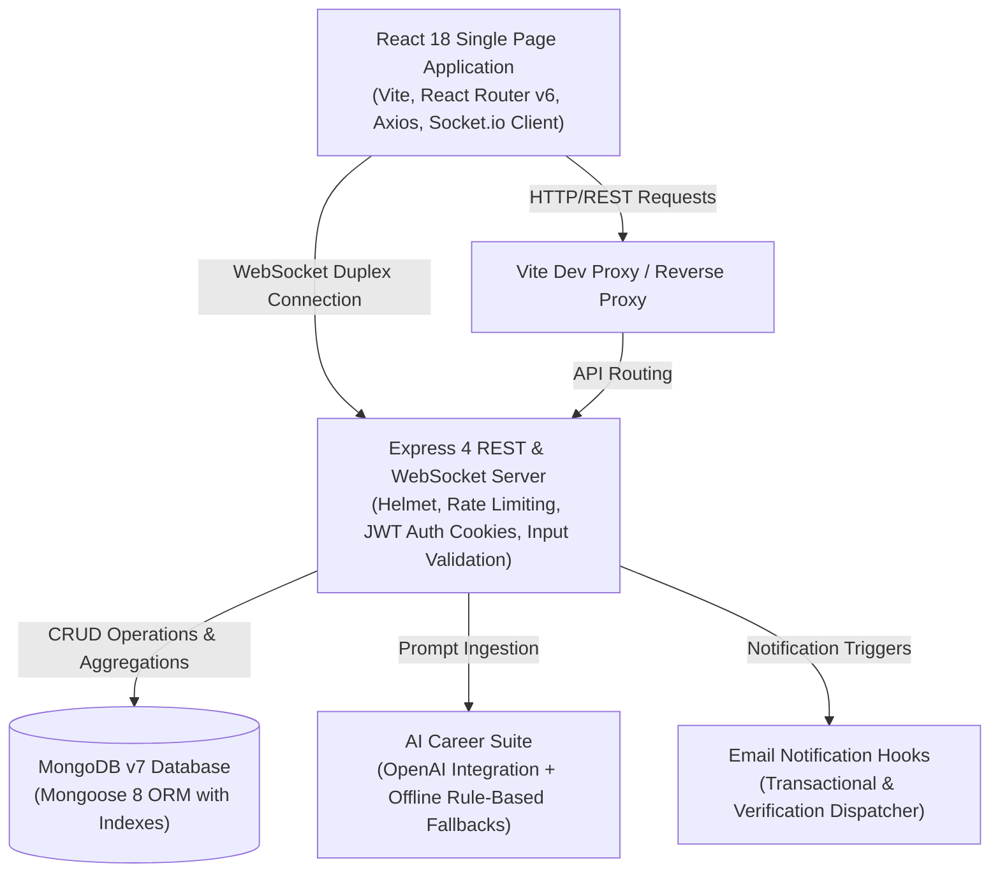

# 🎓 AI Alumni Nexus

> **A production-ready full-stack alumni networking, structured mentorship, and AI-assisted career platform.**

[](https://react.dev/)
[](https://nodejs.org/)
[](https://www.mongodb.com/)
[](https://socket.io/)
[](./tests/api_verification.mjs)
[](./docs/)

---

## 📚 Complete Project Documentation in `/docs`
- 🏛 [System Architecture & Technical Specification](./docs/ARCHITECTURE.md)
- 🔍 [Root-Cause Quality Audit & Defect Diagnoses](./docs/QUALITY_AUDIT.md)
- 📊 [23-Feature Automated & Manual Test Matrix](./docs/FEATURE_TEST_MATRIX.md)
- 📝 [Detailed Changelog & Remediation Log](./docs/CHANGELOG.md)
- 🏆 [Final Quality & Compliance Report](./docs/QUALITY_REPORT.md)

## 📌 Problem Statement & Target Users

University students often struggle to access reliable career advice, mock interviews, and authentic referrals, while alumni lack structured, low-friction platforms to mentor students and review candidates. Generic platforms like LinkedIn do not verify alumni credentials with campus administrative authorities or enforce college-specific mentorship lifecycles.

**Target Users:**
1. **Students:** Discover verified alumni mentors, schedule guidance sessions, apply for exclusive alumni referrals and internships, prepare for technical interviews with AI assistance, and participate in campus events.
2. **Alumni:** Set custom availability schedules, accept/decline mentorship sessions, post job and internship opportunities, review student applicants, and engage in college communities.
3. **Administrators:** Review alumni credential applications (college email domain, registration number, graduation year), manage platform metrics, broadcast announcements, and oversee student-alumni interactions.

---

## 🏗 High-Level Architecture & Data Flow



---

## 🚀 Key Features & Implementation Status

| Feature | Description | Implementation Status |
|---|---|---|
| **Alumni Verification Pipeline** | College email domain verification with 6-digit OTP codes, registration number validation, and admin review dashboard (`pending` → `verified` / `rejected`). | ✅ Fully Implemented & Tested |
| **Mentorship Lifecycle** | Availability status (`available`, `busy`, `unavailable`), time-slot management, booking requests, accept/reject workflow, session completion, and 5-star ratings with reviews. | ✅ Fully Implemented & Tested |
| **Opportunity & Referral Board** | Verified alumni post jobs, internships, hackathons, and referrals; students submit applications; status tracking (`applied` → `reviewing` → `shortlisted` → `selected` / `rejected`). | ✅ Fully Implemented & Tested |
| **Real-Time Direct Chat** | Room-based instant messaging with Socket.io, real-time message broadcasting, typing indicators, and user online/offline presence tracking. | ✅ Fully Implemented & Tested |
| **In-App Notification Center** | Real-time event notifications for messages, mentorship bookings, application status changes, and profile views with read/unread tracking. | ✅ Fully Implemented & Tested |
| **AI Career Guidance Suite** | Skills gap analysis with personalized roadmap, dynamic technical & behavioral mock interview question generator, answer evaluator with scoring, and resume reviewer. | ✅ Operational (with offline fallbacks) |
| **Community Feed & Events** | Social activity feed with rich posts, likes, threaded comments, and campus event registrations. | ✅ Fully Implemented & Tested |
| **Admin Oversight & Analytics** | Platform metrics aggregation (monthly registrations, top skills, top hiring companies, pending approvals) and user role transitions. | ✅ Fully Implemented & Tested |

---

## 💻 Technology Stack

- **Frontend:** React 18.2, Vite 5.4, React Router DOM 6.22, Axios 1.6, Recharts 2.12, Socket.io Client 4.7, React Hot Toast 2.4.
- **Backend:** Node.js 21.6 (ES Modules), Express 4.18, Socket.io 4.7, Mongoose 8.3, JWT (`jsonwebtoken`), `bcryptjs`, `helmet`, `express-rate-limit`, `express-validator`, `cookie-parser`.
- **Database:** MongoDB 7.0 running natively on local host (`localhost:27017`).
- **Testing:** Native Node.js test runner suite (`tests/api_verification.mjs`) verifying 32 end-to-end integration assertions.

---

## ⚙️ Prerequisites

- **Node.js:** v20.x or v21.x (tested on `v21.6.1`)
- **npm:** v10.x (tested on `10.5.2`)
- **MongoDB:** v7.x or v6.x running locally on `localhost:27017` (or MongoDB Atlas URI)

---

## 🛠 Installation & Local Setup

### 1. Clone or Extract Repository
```bash
cd nexus-complete
```

### 2. Configure Environment Variables
Both `server/` and `client/` contain pre-configured `.env` files for local development. Template files with full documentation are provided:
```bash
# Server configuration (server/.env)
PORT=5000
MONGODB_URI=mongodb://127.0.0.1:27017/alumni_nexus
JWT_SECRET=984b85af5d869f424c32492fc51b0a107c84f0fef21148ddef6434e0ae9b10bb185747bab93e0100ec85f8c18f4347e3f51b48181d6e86933ff880293043466f
CORS_ORIGIN=http://localhost:5173
RATE_LIMIT_MAX=300
NODE_ENV=development

# Client configuration (client/.env)
VITE_API_URL=http://localhost:5000
```

### 3. Install Dependencies
```bash
# Install server dependencies
cd server
npm install

# Install client dependencies
cd ../client
npm install
```

### 4. Seed Development Database
Populate the local MongoDB database with initial demo accounts, posts, and events:
```bash
cd ../server
node seed.js
```
*Expected output:*
```
✅ MongoDB connected
✅ Demo accounts created:
   Admin:   admin@nexus.com / admin123
   Alumni:  alumni@nexus.com / alumni123
   Student: student@nexus.com / student123
```

---

## 🏃 Running the Application

### Option A: Unified Monorepo Command (Recommended)
From the project root:
```bash
npm run dev
```
*Spawns both the Express server on port 5000 and the Vite frontend on port 5173.*

### Option B: Separate Terminal Windows

**Terminal 1 — Backend Server:**
```bash
cd server
npm run dev
# Server running on http://localhost:5000
```

**Terminal 2 — Frontend Client:**
```bash
cd client
npm run dev
# Vite client running on http://localhost:5173
```

---

## 🌐 Application URLs & Demo Credentials

- **Frontend Application:** [http://localhost:5173](http://localhost:5173)
- **Backend API Root:** [http://localhost:5000](http://localhost:5000)

### Pre-Seeded Accounts for Evaluation:

| Role | Email | Password | Permissions & Features to Test |
|---|---|---|---|
| **Admin** | `admin@nexus.com` | `admin123` | Analytics dashboard, alumni verification approval/rejection, user role management |
| **Verified Alumni** | `alumni@nexus.com` | `alumni123` | Post opportunities, update mentorship availability, accept mentorship sessions, view applicants |
| **Student** | `student@nexus.com` | `student123` | Book mentorship sessions, apply for opportunities, use AI tools, post on community feed, register for events |

---

## 🧪 Testing & Production Builds

### Run End-to-End Automated Test Suite
From the root directory:
```bash
npm test
```
*Executes 35 assertions covering healthchecks, authentication, role guards, alumni verification rules, mentorship lifecycle, opportunity applications, social feed, and offline AI fallbacks.*

### Verify Production Frontend Build
```bash
npm run build
```
*Compiles the React application with Vite, outputting optimized static assets into `client/dist/`.*

---

## 📁 Repository Directory Structure

```
nexus-complete/
├── client/                     # React 18 Frontend Application
│   ├── src/
│   │   ├── components/         # Reusable UI components (Badge, Sidebar, Topbar)
│   │   ├── context/            # Global state (AuthContext, LayoutContext, SocketContext)
│   │   ├── pages/              # 18 Application views (Admin, Mentorship, Feed, etc.)
│   │   ├── utils/              # Helper utilities (badge formatting, colors)
│   │   ├── api.js              # Centralized Axios client with automatic JWT refresh
│   │   ├── App.jsx             # Route definitions and protected route wrappers
│   │   ├── index.css           # Global modern styling system
│   │   └── main.jsx            # Application entrypoint
│   ├── .env                    # Client environment configuration
│   ├── .env.example            # Client environment documentation template
│   ├── index.html              # HTML shell
│   ├── package.json            # Client dependencies and build scripts
│   └── vite.config.js          # Vite bundler and development proxy configuration
├── server/                     # Node.js + Express Backend Application
│   ├── config/
│   │   └── db.js               # MongoDB Mongoose connection manager
│   ├── middleware/
│   │   ├── auth.js             # JWT verification and role-based guards
│   │   └── validate.js         # Express-validator handlers and pagination parsers
│   ├── models/                 # Mongoose schemas (User, MentorshipSession, etc.)
│   ├── routes/                 # Modular REST API endpoints (auth, mentorship, etc.)
│   ├── utils/                  # Structured error logger, email hooks, notifications
│   ├── .env                    # Server environment configuration
│   ├── .env.example            # Server environment documentation template
│   ├── package.json            # Server dependencies and scripts
│   ├── seed.js                 # Database demographic seeding script
│   └── server.js               # Express app, Socket.io server, and process handlers
├── tests/
│   └── api_verification.mjs    # Comprehensive end-to-end integration test runner
├── .gitignore                  # Git exclude patterns
├── package.json                # Monorepo task orchestration
├── PROJECT_AUDIT.md            # In-depth architectural audit and environment diagnostic
├── PROJECT_WALKTHROUGH.md      # Technical presentation & interview discussion guide
├── README.md                   # Primary project documentation
└── RECOVERY_REPORT.md          # Complete restoration audit and verification log
```

---

## 🔍 Troubleshooting Guide

1. **MongoDB Connection Fails:**
   - Ensure local MongoDB is running: `Get-Service MongoDB` (Windows) or `brew services list` (macOS).
   - Verify `server/.env` contains `MONGODB_URI=mongodb://127.0.0.1:27017/alumni_nexus`.
2. **Port 5173 is already in use:**
   - Vite is configured with `strictPort: false`. If 5173 is busy, Vite will automatically select 5174. The backend server automatically authorizes local origins matching `http://localhost:*` in development mode.
3. **AI features without OpenAI API key:**
   - An OpenAI API key is optional. When omitted, `server/routes/ai.js` activates intelligent rule-based stubs for skill analysis, interview questions, scoring, and resume review.

---

## 🔮 Limitations & Future Improvements

- **Email Delivery:** Currently integrated with development logging hooks; ready for SendGrid/AWS SES API binding.
- **File Uploads:** Profile avatar and resume upload interfaces are prepared; cloud storage (S3/GCS/Cloudinary) can be plugged in for scalable asset hosting.
- **Real-time Video Calls:** Currently supports sharing Google Meet / Zoom meeting links; WebRTC video streaming can be integrated directly.
