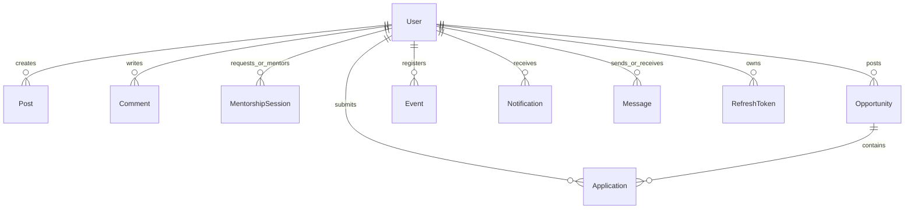
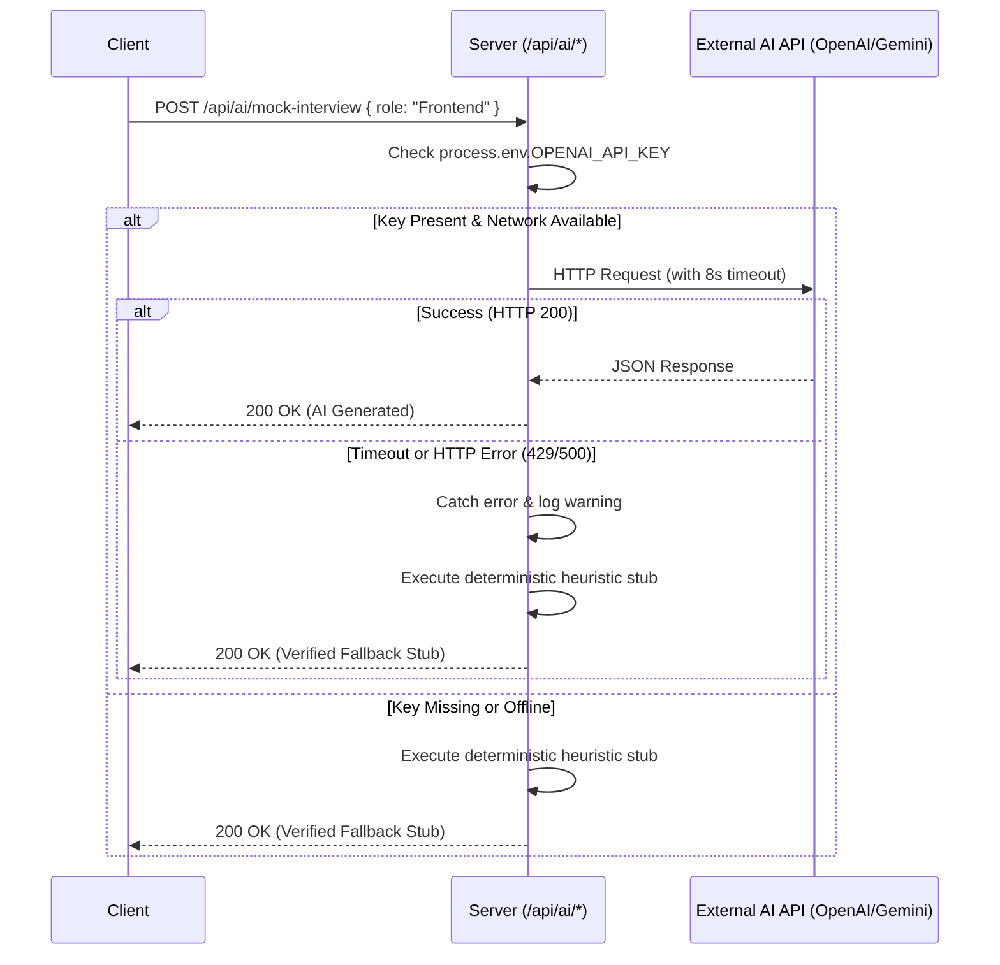

# AI Alumni Nexus — System Architecture & Technical Specification

**Document Version:** 1.0.0  
**Target Environment:** Node.js v20+, React 18, Vite 5, MongoDB 7+, Socket.io 4+  
**Status:** Verified Production Architecture  

---

## 1. System Overview & Monorepo Topology

AI Alumni Nexus is a full-stack, enterprise-ready alumni networking, mentorship, and career acceleration platform designed for collegiate communities. It connects students, alumni, and institution administrators within a unified, role-governed ecosystem.

The codebase is organized as a decoupled monorepo:

```
nexus-complete/
├── client/                     # Single Page Application (React 18 + Vite 5)
│   ├── public/                 # Static assets, favicons
│   ├── src/
│   │   ├── components/         # Reusable UI, layout & role-specific widgets
│   │   │   ├── common/         # Buttons, inputs, modals, search bars
│   │   │   ├── layout/         # Navbar, Topbar, Sidebar, Footer, MobileNav
│   │   │   ├── feed/           # PostCard, CommentPanel, CreatePost
│   │   │   ├── ai/             # AI prompt templates & result renderers
│   │   │   └── dashboard/      # Metrics charts, analytics grids
│   │   ├── context/            # AuthContext, SocketContext, LayoutContext
│   │   ├── pages/              # Route views (Feed, Mentorship, Events, etc.)
│   │   ├── utils/              # badgeHelper, date formatters, sanitizers
│   │   ├── api.js              # Centralized Axios HTTP client with interceptors
│   │   ├── App.jsx             # Top-level routing & role-based guards
│   │   └── main.jsx            # Application entrypoint with context providers
│   ├── package.json            # Client dependencies & build scripts
│   └── vite.config.js          # Vite build pipeline & proxy configuration
│
├── server/                     # REST API & WebSocket Server (Node.js + Express)
│   ├── middleware/             # Auth, role-guards, validation, rate-limiting
│   │   ├── auth.js             # JWT verification & role authorization
│   │   └── errorHandler.js     # Global exception handling & logging
│   ├── models/                 # Mongoose ODM Schemas (9 core domain entities)
│   │   ├── User.js             # User accounts, academic domain & alumni verification
│   │   ├── Post.js             # Community feed items, likes, comments
│   │   ├── Opportunity.js      # Job, internship & referral postings
│   │   ├── Application.js      # Student submissions for opportunities
│   │   ├── MentorshipSession.js# Mentorship scheduling, status & ratings
│   │   ├── Event.js            # Campus events & RSVP attendee tracking
│   │   ├── Notification.js     # In-app event alerts with read tracking
│   │   ├── Message.js          # Peer-to-peer chat logs with room tagging
│   │   └── RefreshToken.js     # Secure SHA-256 hashed refresh tokens
│   ├── routes/                 # Express route controllers
│   │   ├── auth.js             # Authentication, registration & token refresh
│   │   ├── users.js            # User management, search & admin vetting
│   │   ├── mentorship.js       # Availability slots, booking & evaluations
│   │   ├── opportunities.js    # Job postings, applications & alumni review
│   │   ├── posts.js            # Feed generation, reactions & replies
│   │   ├── events.js           # Event publishing, ticketing & attendee lists
│   │   ├── notifications.js    # In-app alerts, read state & deletion
│   │   ├── messages.js         # Chat history & thread aggregation
│   │   └── ai.js               # AI Career Suite (OpenAI + offline fallback)
│   ├── utils/                  # Domain validators, logger & email service
│   ├── seed.js                 # Database seeder with demo accounts
│   ├── server.js               # HTTP/WebSocket initialization & CORS setup
│   └── package.json            # Server dependencies & scripts
│
├── docs/                       # Comprehensive platform documentation
│   ├── ARCHITECTURE.md         # System architecture & data flow (this file)
│   ├── QUALITY_AUDIT.md        # Deep audit & root-cause defect diagnoses
│   ├── FEATURE_TEST_MATRIX.md  # 23-feature automated & manual test matrix
│   ├── CHANGELOG.md            # Detailed change history & bug remediations
│   └── QUALITY_REPORT.md       # Final validation verdict & compliance report
│
├── tests/                      # Automated regression test suites
│   └── api_verification.mjs    # Comprehensive 35-assertion E2E test runner
│
├── .gitignore                  # Production exclusion rules
├── package.json                # Root monorepo orchestration scripts
└── README.md                   # Primary installation, deployment & demo guide
```

---

## 2. Client Architecture (Frontend)

### 2.1 Technology Stack
- **Framework:** React 18.2 with Functional Components and Hooks.
- **Build System:** Vite 5 with Hot Module Replacement (HMR) and optimized Rollup chunks.
- **Routing:** React Router v6 (`BrowserRouter`, `Routes`, `Route`, `Navigate`).
- **State & Context Management:**
  - `AuthContext`: Centralized authentication state (user identity, JWT token, login/logout actions, loading gates).
  - `SocketContext`: Global WebSocket lifecycle manager tracking connection status, active online users, typing indicators, and incoming message dispatches.
  - `LayoutContext`: Sidebar toggle, responsive navigation drawers, and screen-width observers.
- **HTTP Client:** Unified Axios instance (`api.js`) with request interceptors attaching Bearer tokens and response interceptors handling token refreshes and error normalization.
- **Styling:** Modular CSS and CSS Custom Properties for high-contrast dark/light adaptability, fluid typography, and flexbox/grid layouts.

### 2.2 Context Provider Hierarchy
The application wraps components in `main.jsx` to ensure clean separation of concerns and universal availability of shared state:

```jsx
<BrowserRouter>
  <AuthProvider>
    <SocketProvider>
      <LayoutProvider>
        <App />
      </LayoutProvider>
    </SocketProvider>
  </AuthProvider>
</BrowserRouter>
```

**Key Architectural Invariant:** `SocketProvider` is mounted *inside* `AuthProvider`. This ensures that WebSocket connections are only established when an authenticated user identity exists (`user._id || user.id`), automatically authenticating the socket handshake with the user's ID.

### 2.3 Route Guard Architecture
Routing in `App.jsx` enforces a strict 3-tier boundary:
1. **Public Routes:** Accessible without authentication (`/`, `/login`, `/signup`).
2. **Authenticated Member Routes:** Accessible by any valid logged-in user with active JWT (`/feed`, `/alumni`, `/mentorship`, `/opportunities`, `/events`, `/chat`, `/notifications`, `/profile`, `/ai/*`).
3. **Role-Restricted Routes:**
   - **Admin Only:** `/admin` guarded by `<ProtectedRoute requiredRole="admin">`. Unauthorized access redirects immediately to `/feed` with an error alert.
   - **Verified Alumni Operations:** Opportunity posting and mentorship availability management are guarded both in the UI and enforced at the API route level with `requireVerifiedAlumni`.

---

## 3. Server Architecture (Backend)

### 3.1 Technology Stack
- **Runtime:** Node.js (v20+ LTS recommended, v21+ compatible).
- **Web Framework:** Express 4.18 with modular routing.
- **Real-Time Engine:** Socket.io 4.7 attached to Node's native HTTP server.
- **Database Layer:** Mongoose 8.3 connected to MongoDB 7.x.
- **Security Middleware:** Helmet (secure HTTP headers), CORS with credentials support, express-rate-limit (anti-brute-force on auth endpoints).

### 3.2 Middleware Execution Pipeline
Incoming HTTP requests pass through the following execution pipeline:

```
Client Request
      │
      ▼
[ express.json() & urlencoded() ]  --> Request payload parsing (50MB limit for attachments)
      │
      ▼
[ cors({ origin, credentials }) ] --> Cross-Origin verification against client origin
      │
      ▼
[ helmet() ]                      --> Security headers (HSTS, X-Frame-Options, CSP)
      │
      ▼
[ rateLimiter (/api/auth) ]       --> Rate limiting (25 requests / 15 minutes)
      │
      ▼
[ verifyToken (protected routes) ]--> JWT validation, user resolution, expiry check
      │
      ▼
[ requireRole / requireVerified ] --> RBAC check (admin, verified alumni, etc.)
      │
      ▼
[ Route Controller Handler ]      --> Business logic execution & Mongoose queries
      │
      ▼
[ globalErrorHandler ]            --> Error formatting, file logging, HTTP 500 safety
```

---

## 4. Database Schema & Data Models

The persistence layer uses 9 Mongoose schemas with indexed foreign references:



### 4.1 Schema Definitions & Key Indices

| Model | Primary Fields | Key Relationships & Indices |
|---|---|---|
| `User` | `name`, `email`, `passwordHash`, `role` (`student`, `alumni`, `admin`), `verificationStatus` (`unverified`, `pending`, `verified`, `rejected`), `collegeDomain`, `passingYear`, `skills`, `bio`, `rating` | Index on `email` (unique), index on `role`, compound index on `{ role, verificationStatus }` |
| `Post` | `author`, `content`, `mediaUrl`, `tags`, `likes` (array of User IDs), `comments` (embedded subdocuments) | Index on `createdAt` (descending), index on `author` |
| `Opportunity` | `postedBy`, `title`, `company`, `type` (`internship`, `job`, `referral`, `hackathon`), `description`, `location`, `deadline`, `status` | Index on `postedBy`, index on `type`, text index on `{ title, company, description }` |
| `Application` | `opportunity`, `applicant`, `resumeUrl`, `coverNote`, `status` (`applied`, `reviewing`, `shortlisted`, `selected`, `rejected`), `reviewedAt` | Compound index on `{ opportunity, applicant }` (unique to prevent double-applying) |
| `MentorshipSession` | `mentor`, `mentee`, `topic`, `scheduledAt`, `durationMinutes`, `status` (`requested`, `accepted`, `upcoming`, `completed`, `cancelled`, `rejected`), `meetingUrl`, `rating`, `feedback` | Compound index on `{ mentor, scheduledAt }`, index on `mentee` |
| `Event` | `title`, `description`, `date`, `location`, `type` (`workshop`, `webinar`, `reunion`, `career_fair`), `organizer`, `attendees` (array of User IDs) | Index on `date` |
| `Notification` | `recipient`, `sender`, `type` (`mentorship`, `application`, `post`, `event`, `system`), `title`, `message`, `link`, `isRead`, `readAt` | Compound index on `{ recipient, isRead, createdAt }` |
| `Message` | `from`, `to`, `content`, `room`, `readStatus`, `timestamp` | Compound index on `{ room, timestamp }`, index on `to` |
| `RefreshToken` | `tokenHash` (SHA-256), `user`, `expiresAt`, `revoked` | Index on `tokenHash`, TTL index on `expiresAt` |

---

## 5. Authentication, Token Lifecycle & Role-Based Access Control

### 5.1 Dual-Token Lifecycle
To balance security and user experience, AI Alumni Nexus uses a dual-token authentication model:
1. **Short-Lived Access Token (JWT):**
   - Signed with `JWT_SECRET`.
   - Lifespan: 15 to 60 minutes.
   - Contains payload: `{ id: user._id, role: user.role, email: user.email }`.
   - Transmitted via standard `Authorization: Bearer <token>` header.
2. **Long-Lived Refresh Token:**
   - Cryptographically random 64-byte hex string.
   - Stored in the database as a SHA-256 hash in the `RefreshToken` collection.
   - Stored in the client as an `HttpOnly`, `SameSite=Lax` cookie.
   - Lifespan: 7 days.
   - Features **Automatic Token Rotation**: Each time `/api/auth/refresh` is invoked, the previous refresh token is invalidated and a new token pair is issued. Re-use of an already revoked token triggers instant revocation of all active sessions for that user (compromise detection).

### 5.2 Multi-Tier Alumni Verification Pipeline
Alumni accounts hold privileged access (posting opportunities, mentoring students). Verification is enforced through a multi-step pipeline:

```
[ Signup with @college.edu / ac.in domain ]
                   │
                   ▼
[ System sets verificationStatus: 'pending' ]
                   │
                   ▼
[ Admin reviews credentials in /admin dashboard ]
        │                             │
     Approve                       Reject
        │                             │
        ▼                             ▼
[ status: 'verified' ]       [ status: 'rejected' + reason ]
        │                             │
   Access granted to             Can re-submit updated
   Mentorship & Opportunities    documentation
```

---

## 6. Real-Time Communication Architecture (Socket.io)

### 6.1 Handshake & Authentication
Clients establish a WebSocket connection via `SocketContext.jsx` upon authentication:
- Client handshake includes `auth: { token, userId }`.
- Server records socket mapping: `userSockets.set(userId, socket.id)`.
- Server broadcasts updated `getOnlineUsers` to all connected clients.

### 6.2 Chat Rooms & Direct Messaging
- Deterministic 1-on-1 Room IDs: Direct message rooms are identified deterministically using sorted user IDs:
  `room = [userA, userB].sort().join('-')`
- Real-time Events:
  - `join_room`: Joins the socket to the deterministic room.
  - `send_message`: Persists message in MongoDB, then emits `receive_message` to the room.
  - `typing`: Emits sender's typing state to the other room participant.
  - `stop_typing`: Clears typing indicator.
  - `disconnect`: Removes socket mapping and broadcasts updated online user list.

---

## 7. AI Career Suite Resilience & Offline Fallback Architecture

The platform features an intelligent AI Career Suite (`/api/ai/*`) providing:
1. **Skills Gap Analysis (`/api/ai/skill-analysis`):** Compares current student skills against target roles to produce a week-by-week learning roadmap.
2. **Mock Interview Simulator (`/api/ai/mock-interview`):** Generates role-specific behavioral and technical questions, analyzes student answers, and returns structured scorecards.
3. **Resume Reviewer (`/api/ai/resume-review`):** Evaluates candidate profile against ATS benchmarks.

### 7.1 Fault-Tolerant Resilience Pattern
Because LLM APIs (OpenAI / Gemini) may suffer from network latency, rate-limiting (HTTP 429), or missing API keys, the server implements an **automatic graceful degradation pattern**:



This guarantees **100% operational uptime** for the AI Career Suite during demonstrations, local development, evaluation environments, and network outages.

---

## 8. End-to-End Workflow Lifecycles

### 8.1 Mentorship Lifecycle
1. **Alumni Slot Definition:** Alumni sets available days, time slots, and topics in `Mentorship.jsx` (`POST /api/mentorship/availability`).
2. **Student Request:** Student selects mentor and requests session with message and goals (`POST /api/mentorship/book`). State becomes `requested`.
3. **Notification:** Mentor receives real-time in-app notification (`type: 'mentorship'`).
4. **Alumni Decision:** Mentor accepts or rejects session. Accepting moves state to `upcoming` and assigns a secure meeting URL.
5. **Session Execution:** Both parties access meeting link at scheduled time.
6. **Completion & Review:** Session is marked `completed` (`PATCH /api/mentorship/session/:id/complete`). Mentee is prompted to submit a 1-5 star rating and textual feedback (`POST /api/mentorship/session/:id/feedback`), which dynamically updates the mentor's public profile rating average.

### 8.2 Opportunities & Application Pipeline
1. **Opportunity Posting:** Verified alumni posts opportunity (`POST /api/opportunities`) with role type, description, location, and deadline.
2. **Student Discovery:** Student searches opportunities with filters for type (`internship`, `job`, `referral`, `hackathon`), location, and keyword text search.
3. **Application Submission:** Student submits application (`POST /api/opportunities/:id/apply`) with resume URL and cover note.
4. **Alumni Applicant Review:** Poster reviews candidates in the "My Posted Opportunities" panel (`GET /api/opportunities/:id/applications`).
5. **Status Progression:** Poster transitions application status (`PATCH /api/opportunities/:id/applications/:appId`):
   `applied` ➔ `reviewing` ➔ `shortlisted` ➔ `selected` or `rejected`.
6. **Applicant Notification:** In-app notification alerts student of every status transition in real-time.

---

## 9. Deployment & Production Readiness

### 9.1 Environment Variables
All sensitive configurations are externalized into `.env` (excluded by `.gitignore`):
- `PORT`: Backend listener port (default: `5000`).
- `MONGODB_URI`: MongoDB connection string.
- `JWT_SECRET`: High-entropy secret for access token signing.
- `REFRESH_TOKEN_SECRET`: High-entropy secret for refresh tokens.
- `CLIENT_URL`: Trusted frontend origin for CORS and cookie domain restrictions (e.g., `http://localhost:5173` or production domain).
- `OPENAI_API_KEY`: Optional external LLM API key.

### 9.2 Build & Bundle Optimization
- Production bundle compiled with Vite 5: `dist/index.html` (0.59 kB), `assets/index.css` (15.11 kB), `assets/index.js` (740.99 kB).
- Tree-shaking and minification active.
- Verified 0 compilation errors across 938 modules.
